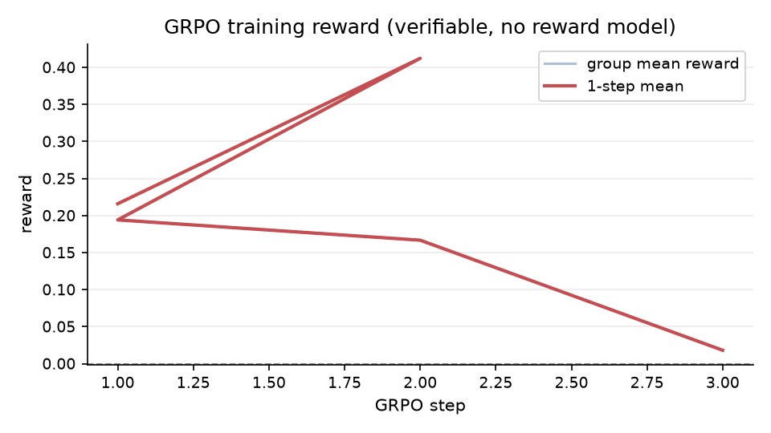
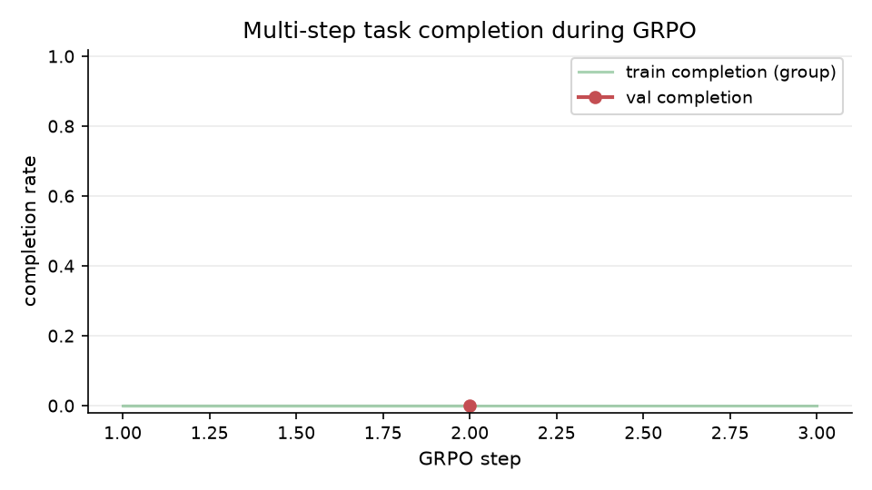
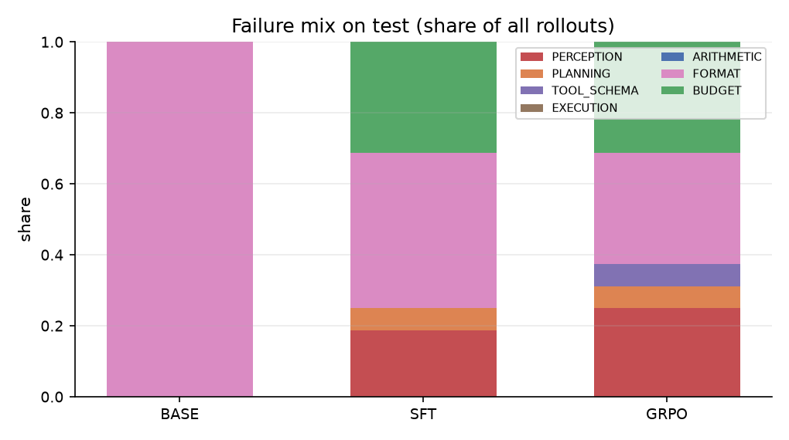
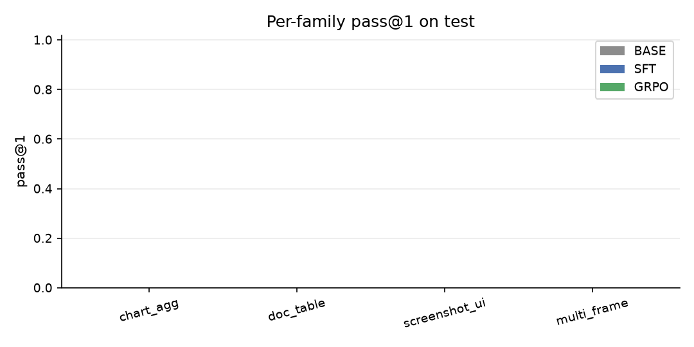
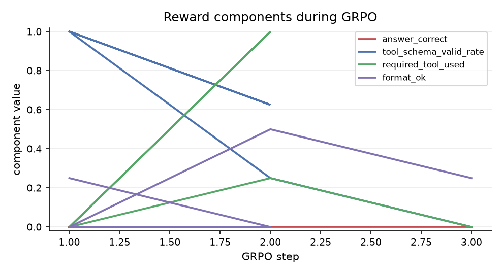
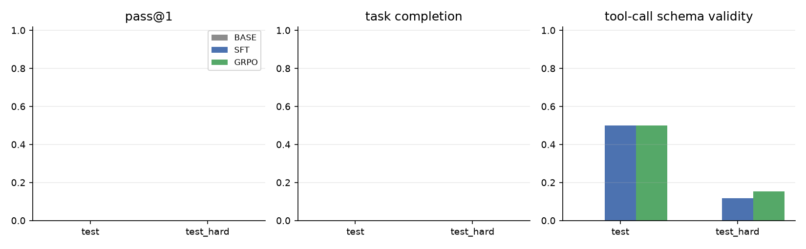

# VLM-GRPO results

All numbers below are generated by `scripts/make_results_table.py` from `results/results.json`, which is written only by executed evaluation runs.

## Environment

model tier **tiny** (256,484,928 params), device **mps**, dtype **float32**, seed **1234**, SFT steps **150**, GRPO steps **3**, train wall **0.55 h**, eval wall **0.98 h**, total **1.52 device-hours**.

## Headline metrics

| split | checkpoint | pass@1 | pass@4 | task completion | tool schema valid | mean turns | perception recall |
|---|---|---:|---:|---:|---:|---:|---:|
| test | BASE | 0.000 | 0.000 | 0.000 | 0.000 | 3.88 | 0.101 |
| test | SFT | 0.000 | 0.000 | 0.000 | 0.500 | 3.06 | 0.247 |
| test | GRPO | 0.000 | 0.000 | 0.000 | 0.500 | 2.75 | 0.247 |
| test_hard | BASE | 0.000 | 0.000 | 0.000 | 0.000 | 4.00 | 0.063 |
| test_hard | SFT | 0.000 | 0.000 | 0.000 | 0.118 | 2.81 | 0.266 |
| test_hard | GRPO | 0.000 | 0.000 | 0.000 | 0.154 | 2.62 | 0.289 |

## Deltas vs BASE and vs SFT

Absolute deltas (relative in parentheses). `vs BASE` shows the full effect of post-training; `vs SFT` isolates the RLVR step.

| split | checkpoint | reference | pass@1 | completion | schema valid | perception recall |
|---|---|---|---:|---:|---:|---:|
| test | BASE | SFT | +0.000 (n/a) | +0.000 (n/a) | -0.500 (-100.0%) | -0.146 (-59.3%) |
| test | SFT | BASE | +0.000 (n/a) | +0.000 (n/a) | +0.500 (n/a) | +0.146 (+145.7%) |
| test | GRPO | BASE | +0.000 (n/a) | +0.000 (n/a) | +0.500 (n/a) | +0.146 (+145.7%) |
| test | GRPO | SFT | +0.000 (n/a) | +0.000 (n/a) | +0.000 (+0.0%) | +0.000 (+0.0%) |
| test_hard | BASE | SFT | +0.000 (n/a) | +0.000 (n/a) | -0.118 (-100.0%) | -0.202 (-76.2%) |
| test_hard | SFT | BASE | +0.000 (n/a) | +0.000 (n/a) | +0.118 (n/a) | +0.202 (+319.6%) |
| test_hard | GRPO | BASE | +0.000 (n/a) | +0.000 (n/a) | +0.154 (n/a) | +0.226 (+357.2%) |
| test_hard | GRPO | SFT | +0.000 (n/a) | +0.000 (n/a) | +0.036 (+30.8%) | +0.024 (+9.0%) |

## Per-family breakdown (test)

| family | checkpoint | pass@1 | task completion | tool schema valid | perception recall |
|---|---|---:|---:|---:|---:|
| chart_agg | BASE | 0.000 | 0.000 | 0.000 | 0.100 |
| chart_agg | SFT | 0.000 | 0.000 | 0.000 | 0.050 |
| chart_agg | GRPO | 0.000 | 0.000 | 0.000 | 0.050 |
| doc_table | BASE | 0.000 | 0.000 | 0.000 | 0.094 |
| doc_table | SFT | 0.000 | 0.000 | 0.500 | 0.438 |
| doc_table | GRPO | 0.000 | 0.000 | 0.250 | 0.438 |
| screenshot_ui | BASE | 0.000 | 0.000 | 0.000 | 0.125 |
| screenshot_ui | SFT | 0.000 | 0.000 | 0.000 | 0.000 |
| screenshot_ui | GRPO | 0.000 | 0.000 | 0.000 | 0.000 |
| multi_frame | BASE | 0.000 | 0.000 | 0.000 | 0.083 |
| multi_frame | SFT | 0.000 | 0.000 | 0.750 | 0.500 |
| multi_frame | GRPO | 0.000 | 0.000 | 0.625 | 0.500 |

## Failure attribution (test)

| checkpoint | perception | planning | tool_schema | execution | arithmetic | format | budget | success | dominant |
|---|---:|---:|---:|---:|---:|---:|---:|---:|---|
| BASE | 0 | 0 | 0 | 0 | 0 | 16 | 0 | 0 | FORMAT |
| SFT | 3 | 1 | 0 | 0 | 0 | 7 | 5 | 0 | FORMAT |
| GRPO | 4 | 1 | 1 | 0 | 0 | 5 | 5 | 0 | FORMAT |


| checkpoint | perception | planning | tool_schema | execution | arithmetic | format | budget | success | dominant |
|---|---:|---:|---:|---:|---:|---:|---:|---:|---|
| BASE | 0 | 0 | 0 | 0 | 0 | 16 | 0 | 0 | FORMAT |
| SFT | 6 | 0 | 0 | 1 | 0 | 9 | 0 | 0 | FORMAT |
| GRPO | 5 | 0 | 1 | 1 | 0 | 9 | 0 | 0 | FORMAT |

## Training and cost

| stage | steps | wall clock | signal |
|---|---:|---:|---|
| SFT (LoRA) | 150 | 25.3 min | final val loss 0.1342 |
| GRPO | 3 | 7.5 min | reward 0.194 -> 0.018, completion 0.000 -> 0.000, skipped groups 1 |

GRPO throughput measured during this run: **1.6 rollouts/min**, mean step **112.5 s**, peak memory **5281 MB**, KL beta 0.02, clip eps 0.2.

## What improved, what did not

- **GRPO did not change pass@1** vs SFT on test.
- Multi-step task completion was unchanged vs SFT.
- Tool-call schema validity was unchanged vs SFT.
- Perception recall was unchanged vs SFT.
- ReAct format compliance changed by +0.125 vs SFT on test.
- Mean turns per episode changed by +0.31 (positive = shorter trajectories).
- Absolute GRPO test numbers: pass@1 **0.000**, completion **0.000**, schema **0.500**; on test_hard pass@1 **0.000**.
- Dominant failure bucket: **FORMAT** for BASE -> **FORMAT** for GRPO (test).
- Buckets reduced by GRPO: FORMAT (-11).

## Limitations

- **Small model / single hardware tier.** All numbers are from the `tiny` tier on `mps`; the `small`/`base` CUDA tiers are wired but not exercised on this machine.
- **Synthetic task suite.** Tasks are generated locally from seed 1234 and are not a substitute for real-world chart/document/screenshot benchmarks.
- **Small evaluation sample.** 4 items per split (stratified across 4 families) with k=4; pass@4 therefore rests on a handful of items per family and has wide error bars.
- **Single training seed.** SFT and GRPO were run once with seed 1234; no seed-variance error bars are reported.
- **Teacher-forced SFT targets** come from executing the gold tool sequence; the model never sees alternative valid strategies during cold start.
- **Perception recall** counts facts that appear anywhere in the model text, tool arguments or tool observations; a retrieval tool call can therefore surface a fact without the model reading it.

## Figures













## Reproducibility

```bash
pip install -r requirements.txt
make data          # deterministic suite + PNGs
make eval-base     # BASE zero-shot
make sft           # LoRA SFT cold start
make grpo          # GRPO/RLVR
make eval-all      # {BASE,SFT,GRPO} x {test,test_hard} -> results/results.json
make report        # regenerate this file and the README tables
```

Commit: `92d1644`.
